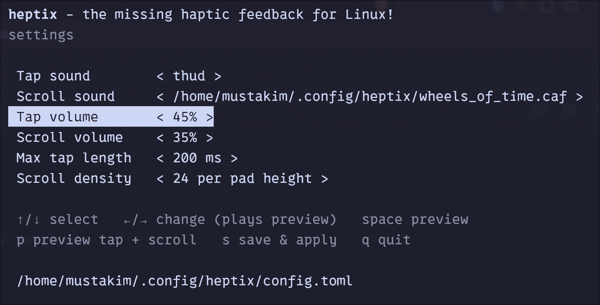

# heptix

**The missing haptic feedback for Linux!**

Plays a short sound when you tap or press the touchpad, and a tick as you
scroll with two fingers. Also plays mechanical keyboard sounds as you type
(Model M by default; set `keyboard_sound = "off"` to disable). Works on X11 and Wayland (reads input devices via evdev).



## Install

**Quick install** (latest release):

```sh
curl -fsSL https://raw.githubusercontent.com/mustakimali/heptix/main/install.sh | sh
```

Installs the latest release to `~/.local/bin`, runs it as a systemd user
service, and opens the settings editor. Needs systemd and an audio server
(PipeWire, PulseAudio or ALSA). If no audio player (`pw-cat`, `paplay` or
`aplay`) is installed, the script installs the one matching your sound server
with `apt`, `dnf`, `pacman` or `zypper` (asks for sudo).

**From source** (needs a Rust toolchain):

```sh
git clone https://github.com/mustakimali/heptix
cd heptix
make install
```

Builds and installs to `~/.local/bin` and starts the systemd user service.
Pass options with `make install ARGS="--keyboard-sound thock --volume 80"`.

Reading the touchpad needs the `input` group. The script adds you with `sudo`
(log out and in afterwards). On NixOS add `"input"` to
`users.users.<you>.extraGroups` instead.

## Dependencies

The release binary is a single static file with all sounds built in. At runtime
it needs:

- Linux with systemd (for the background service).
- An audio player on `PATH`: `pw-cat` (PipeWire), `paplay` (PulseAudio) or
  `aplay` (ALSA). The installer adds one if missing.
- Membership in the `input` group, to read `/dev/input/event*`.

Building from source also needs a Rust toolchain.

## Privacy

- Keystrokes are never logged, stored or sent anywhere. For each key event
  heptix only uses the key code and whether it went down or up, to pick which
  click to play, and nothing else is kept. `--verbose` never prints key presses.
- heptix makes no network connections. The background service is also run with
  the network locked down (`RestrictAddressFamilies=AF_UNIX`,
  `IPAddressDeny=any`, `NoNewPrivileges=yes` in the systemd unit), so it can
  only talk to local unix sockets such as your audio server.
- Keyboard sound is on by default; set `keyboard_sound = "off"` to stop heptix
  reading keyboards at all.

## Use

- `heptix` opens the settings editor (sound, volumes, tap length, scroll
  density; changes preview as you make them, `s` saves and restarts the service).
- `heptix --run` runs with the saved settings; other options override them
  (`heptix --help`).
- Settings: `~/.config/heptix/config.toml` (created on first run).
- Keyboard sounds (on by default, `bucklespring`): set `keyboard_sound` to
  `off`, `thock`, `clicky`, `linear`, `buckling` (synthesised Model M-style
  spring ping) or `bucklespring` (or use the editor). Separate down/up strokes, different sounds
  for space and wide keys, and slight per-key pitch and level variation.
  Keystrokes are never logged, stored or sent anywhere: an event only picks
  which click to play, and `--verbose` never prints key presses.
  `bucklespring` plays recorded IBM Model M samples built into the binary
  (from [bucklespring](https://github.com/zevv/bucklespring), GPL-2.0).
  To use your own recordings, set `keyboard_sound` to a directory of
  `<hex keycode>-0.wav` (press) and `-1.wav` (release) files.
- Sounds: `thud` (default tap), `haptic`, `tock`, `tick`, `crown` (default
  scroll), `wheel_of_time` (a recorded picker-wheel tick, good for scrolling), or your own 16-bit WAV / linear-PCM CAF file path.

## Build

```sh
cargo build --release     # or: nix run github:mustakimali/heptix
make install              # install + start the service from source (see Install)
```

Uninstall: `systemctl --user disable --now heptix; rm ~/.local/bin/heptix`

Linux only. Releases are published automatically when `version` in
`Cargo.toml` is bumped on the default branch.

## License

GPL-2.0-only. Releases up to and including 0.2.0 were published under the MIT license.
