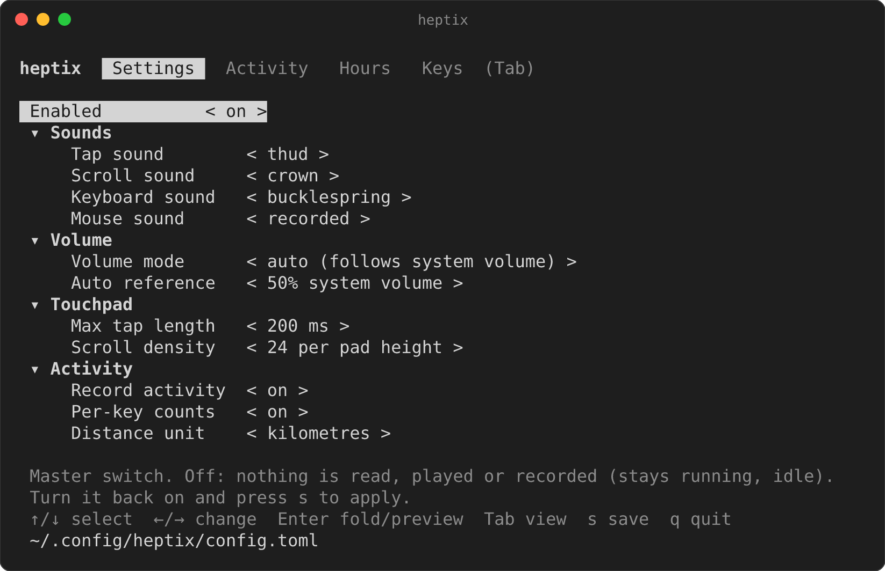
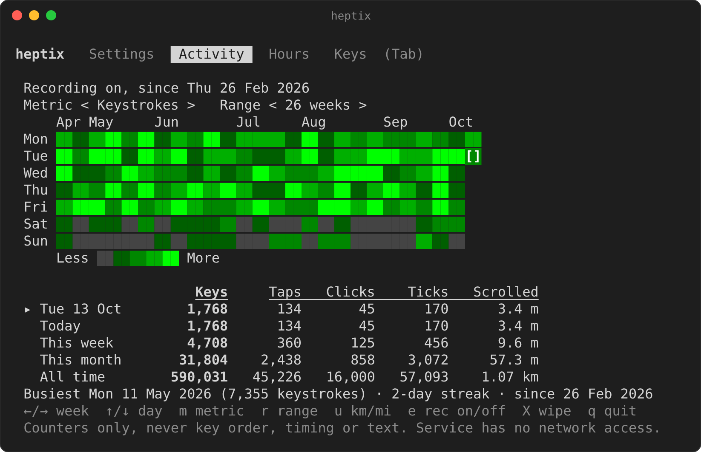
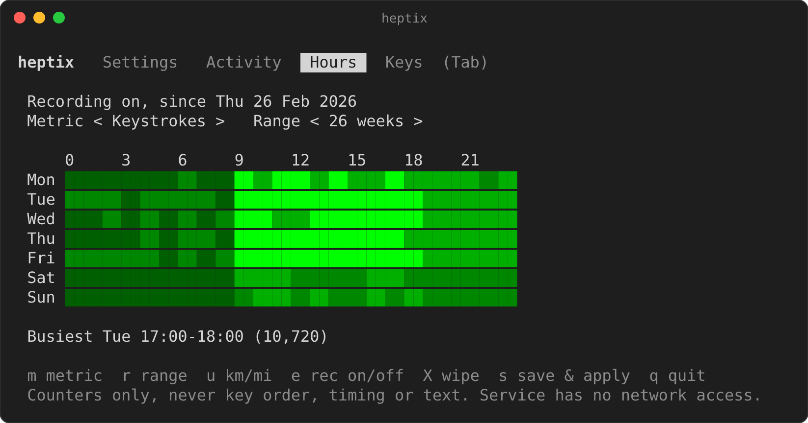
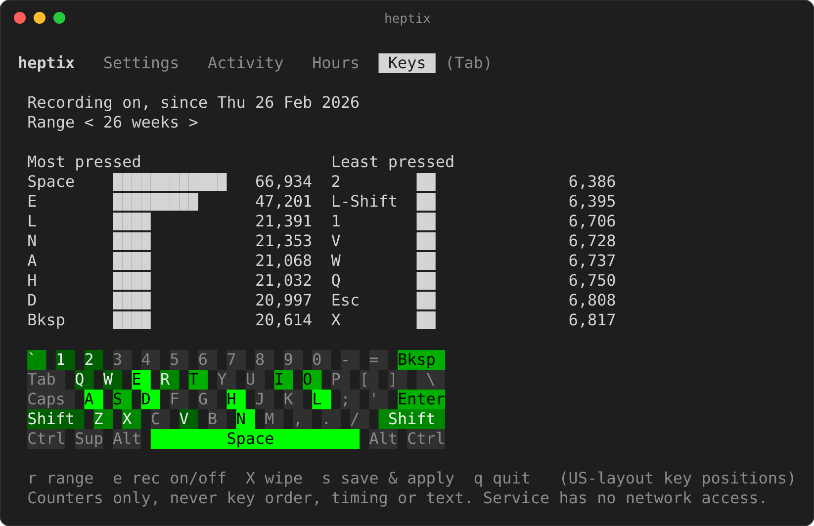

# heptix

**The missing haptic feedback for Linux!**

Plays a short sound when you tap or press the touchpad, and a tick as you
scroll with two fingers. Also clicks for mouse buttons and ticks for the mouse
wheel. Also plays mechanical keyboard sounds as you type
(Model M by default; set `keyboard_sound = "off"` to disable). Works on X11 and Wayland (reads input devices via evdev).

<p align="center"></p>

The Activity view shows when and how much you type, tap and scroll. The images
here use made-up data (see `tools/render_screenshots.py`).

<p align="center"></p>

<table>
  <tr>
    <td></td>
    <td></td>
  </tr>
</table>

## Install

**Quick install** (latest release):

```sh
curl -fsSL https://raw.githubusercontent.com/mustakimali/heptix/main/install.sh | sh
```

Installs the latest release to `~/.local/bin`, runs it as a systemd user
service, and opens the settings editor. Needs systemd and an audio server
(PipeWire, PulseAudio or ALSA). If no audio player (`pw-cat`, `paplay` or
`aplay`) is installed, the script installs the one matching your sound server
with `apt`, `dnf`, `pacman` or `zypper` (asks for sudo).

**From source** (needs a Rust toolchain):

```sh
git clone https://github.com/mustakimali/heptix
cd heptix
make install
```

Builds and installs to `~/.local/bin` and starts the systemd user service.
Pass options with `make install ARGS="--keyboard-sound thock --volume 80"`.

Reading the touchpad needs the `input` group. The script adds you with `sudo`
(log out and in afterwards). On NixOS add `"input"` to
`users.users.<you>.extraGroups` instead.

## Dependencies

The release binary is a single static file with all sounds built in. At runtime
it needs:

- Linux with systemd (for the background service).
- An audio player on `PATH`: `pw-cat` (PipeWire), `paplay` (PulseAudio) or
  `aplay` (ALSA). The installer adds one if missing.
- Membership in the `input` group, to read `/dev/input/event*`.

Building from source also needs a Rust toolchain.

## Privacy

**heptix cannot send your data anywhere.** The background service runs in
lockdown mode: systemd blocks all network access for it
(`RestrictAddressFamilies=AF_UNIX`, `IPAddressDeny=any`, `NoNewPrivileges=yes`
in the unit file). It cannot open an IPv4 or IPv6 socket at all, only local
unix sockets such as your audio server. So there are no analytics, no crash
reports, no update checks and no phoning home, and the code has no networking
dependencies to begin with. (A copy you start by hand, such as the settings
editor, is not under the unit's restrictions, but it contains no network code
either.)

What heptix records, because activity stats are on by default:

- **Counters only**: totals per hour (keystrokes, touchpad taps, clicks
  from the touchpad or a mouse, scroll ticks from the touchpad or a mouse wheel, and how far your fingers travelled while scrolling), and how
  often each key was pressed per day.
- **Never**: which keys you pressed in what order, the time between keys, the
  text you typed, window titles or anything else. Counts can still show
  habits, such as when you are at the computer.
- **Where**: `~/.local/state/heptix/stats.tsv`, readable only by you, kept for
  53 weeks plus all-time totals. It never leaves your machine.
- **Control**: turn it off with `stats = false` (or in the editor), stop only
  the per-key counts with `stats_keys = false`, and delete everything with
  `heptix --stats-reset` or `X` in the Activity view.

Keyboard and mouse sounds (also on by default) only react to a key or button
going down or up, and to wheel notches, to pick a sound. Mouse movement events
are read and discarded at once; nothing about them is kept. `--verbose` never prints key presses. Set `keyboard_sound = "off"`
and `stats = false` and heptix stops reading keyboards altogether.

## Use

- `heptix` opens the settings editor (sound, volumes, tap length, scroll
  density; changes preview as you make them, `s` saves and restarts the service).
- The Settings view groups related options under **Sounds**, **Volume**,
  **Touchpad** and **Activity** headers (`Enter` or `←/→` on a header folds it),
  with a short explanation of the selected item underneath. In auto volume mode
  only the mode and the auto reference are shown; custom mode shows the four
  volumes. On small terminals the list scrolls.
- The editor also has **Activity**, **Hours** and **Keys** views (`Tab` to
  switch): a GitHub-style heatmap of your keystrokes, touchpad taps, clicks,
  scroll ticks or scroll distance by day, a weekday-by-hour grid of when you
  are active, your most and least used keys (plus a keyboard heatmap), and how
  far you have scrolled today, this week and in total (km or miles, `u` to
  switch). Under the Activity heatmap a table gives keys, taps, clicks, scroll
  ticks and scroll distance for the selected day, today, this week, this month
  and all time. `heptix --stats` prints a text summary with the same table. See Privacy for what is stored.
- `heptix --run` runs with the saved settings; other options override them
  (`heptix --help`).
- Settings: `~/.config/heptix/config.toml` (created on first run). `enabled` at
  the top is a master switch: set it to `false` (or turn off **Enabled**, the
  first row in the editor) and heptix goes idle. It reads no input, plays
  nothing and records nothing, and a restart after turning it back on resumes it.
- Keyboard sounds (on by default, `bucklespring`): set `keyboard_sound` to
  `off`, `thock`, `clicky`, `linear`, `buckling` (synthesised Model M-style
  spring ping) or `bucklespring` (or use the editor). Separate down/up strokes, different sounds
  for space and wide keys, and slight per-key pitch and level variation.
  A key event only picks which click to play (see Privacy).
  `bucklespring` plays recorded IBM Model M samples built into the binary
  (from [bucklespring](https://github.com/zevv/bucklespring), GPL-2.0).
  To use your own recordings, set `keyboard_sound` to a directory of
  `<hex keycode>-0.wav` (press) and `-1.wav` (release) files.
- Volume: `volume_mode` is `auto` (default) or `custom`. Auto plays heptix
  quieter as your system volume rises, so it is never too loud at full system
  volume; at or below `auto_reference` (default 50% on the volume slider) sounds
  play at their normal level. The per-sound volumes (`volume`, `scroll_volume`,
  `keyboard_volume`) are locked in auto mode and used as set in `custom` mode.
  The system volume is read with `wpctl` (PipeWire) or `pactl`, only while
  sounds are playing; without either tool auto mode changes nothing.
- Mouse: `mouse_sound` (`recorded` by default, a real recording of a click and
  its release; or the synthesised `tactile` and `soft`, or `off`) plays a
  different sound for button down and button up, tuned slightly per button. The wheel plays one `scroll_sound` tick per notch (rate limited, and
  smooth-scrolling wheels still tick once per notch's worth of movement). Only
  buttons and the wheel are used. A touchpad's own pointer device is skipped and
  repeated events are dropped, so nothing is played or counted twice.
- Hotplug: keyboards, mice and receivers you plug in later are picked up
  automatically (and picked up again after being unplugged); no restart needed.
  `heptix --list` shows what is detected.
- Sounds: `thud` (default tap), `haptic`, `tock`, `tick`, `crown` (default
  scroll), `wheel_of_time` (a recorded picker-wheel tick, good for scrolling), or your own 16-bit WAV / linear-PCM CAF file path.

## Build

```sh
cargo build --release     # or: nix run github:mustakimali/heptix
make install              # install + start the service from source (see Install)
```

Uninstall: `systemctl --user disable --now heptix; rm ~/.local/bin/heptix`

Linux only. Releases are published automatically when `version` in
`Cargo.toml` is bumped on the default branch.

## License

GPL-2.0-only. Releases up to and including 0.2.0 were published under the MIT license.
